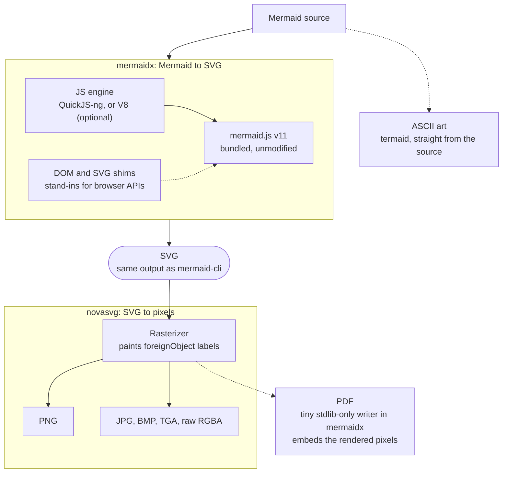
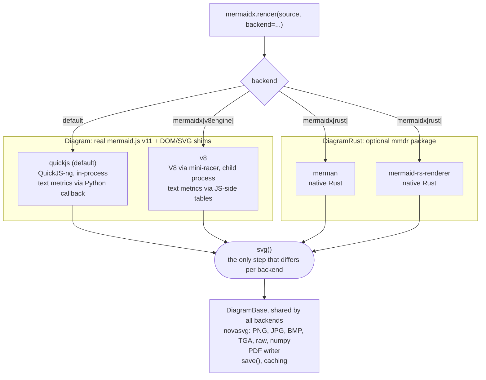

<div align="center">


# mermaidx

**Mermaid diagrams → SVG, PNG, JPG, PDF and ASCII, from plain Python.**<br/>
No browser. No Node.js. No system packages. Just `pip install mermaidx`.

[](https://pypi.org/project/mermaidx)
[](https://pypi.org/project/mermaidx)
[](https://opensource.org/licenses/MIT)
[](https://github.com/MohammadRaziei/mermaidx/actions/workflows/wheel.yml)
[](https://github.com/MohammadRaziei/mermaidx/stargazers)

[Documentation](https://mohammadraziei.github.io/mermaidx) ·
[Quick start](#quick-start) ·
[How it works](#how-it-works) ·
[Python API](#python-api) ·
[CLI](#cli) ·
[Changelog](CHANGELOG.md)

</div>

---

```python
import mermaidx

d = mermaidx.render("graph TD; A[Install] --> B[Import] --> C[Convert] --> D[Done]")
d.save("diagram.svg")
d.save("diagram.png", scale=2.0)
```

`mermaidx` runs the **real Mermaid v11 JavaScript library** inside a small embedded JS engine instead of a headless Chrome. The result is the same SVG you would get from the official `mermaid-cli`, produced without spawning a browser, which makes it a good fit for CI pipelines, notebooks and serverless functions.

## Highlights

- **Browserless.** No Chromium (~170 MB), no Puppeteer, no Node.js, no compiler. Prebuilt wheels only.
- **The real Mermaid.** Not a reimplementation and not a subset: every diagram type Mermaid v11 supports.
- **Many outputs.** SVG, PNG, JPG/JPEG, BMP, TGA, PDF, raw RGBA, NumPy arrays and terminal ASCII art.
- **One process.** Synchronous, in-process rendering, plus `render_many()` for parallel batches.
- **Jupyter-ready.** A diagram displays itself as the last expression of a cell.
- **Pluggable backends.** QuickJS-ng (default), V8 (optional) or native Rust (optional).

## Installation

```bash
pip install mermaidx
```

Extras are opt-in:

| Command | Adds |
| --- | --- |
| `pip install mermaidx` | Base install. Default `backend="quickjs"`, zero system dependencies. |
| `pip install mermaidx[v8engine]` | Real V8 (`mini-racer`) as `backend="v8"`. Faster thanks to JIT, runs in an isolated child process. |
| `pip install mermaidx[rust]` | Native-Rust backends via [`mmdr`](https://github.com/mohammadraziei/mmdr): `merman` and `mermaid-rs-renderer`. |
| `pip install numpy` | Enables `.numpy()` export. |
| `pip install mermaidx[all]` | Every extra above (`v8engine` + `rust` + `numpy`). |

> [!NOTE]
> Coming from `mmdc`? That was this project's old name (until 0.7.0). It is no longer published, so uninstall it and install `mermaidx` instead. The module name changed from `mmdc` to `mermaidx` too. See [History](#history).

## Quick start

[](https://colab.research.google.com/github/mohammadraziei/mermaidx/blob/master/examples/jupyter_demo.ipynb)

```python
import mermaidx

d = mermaidx.render("""
graph TD
    A[Install] --> B[Import]
    B --> C[Convert]
    C --> D[Done]
""")

d.save("diagram.svg")
d.save("diagram.png", scale=2.0)
d.save("diagram.jpg", quality=90)       # also .jpeg / .bmp / .tga
d.save("diagram.pdf", pdf_format="A4")
print(d.ascii())
```

The same from the command line:

```bash
mermaidx -i diagram.mermaid -o diagram.svg
mermaidx -i diagram.mermaid -o diagram.png --scale 2.0
cat diagram.mermaid | mermaidx -i - -o diagram.pdf
```

In Jupyter there is nothing to call. A `Diagram` renders itself, like a DataFrame or a matplotlib figure:

```python
mermaidx.render("flowchart LR; A-->B-->C")   # just shows up
```

## How it works

`mermaidx` has a deliberately narrow job: **turn Mermaid source into an SVG that matches `mermaid-cli`**. Everything after the SVG (PNG, JPG and friends) is [novasvg](https://github.com/mohammadraziei/novasvg)'s job.



| Stage | Who does it | Notes |
| --- | --- | --- |
| **Mermaid → SVG** | `mermaidx` | `mermaid.js` runs unmodified in QuickJS-ng (or V8) against a minimal fake DOM/SVG layer (the shims). Anything a real browser would answer, such as text size via `getBBox`, comes from novasvg's font stack and one bundled font. |
| **SVG → PNG / JPG / BMP / TGA / raw** | [`novasvg`](https://github.com/mohammadraziei/novasvg) | Same bundled font as the layout step, so what Mermaid measured is exactly what gets painted. JPEG has no alpha, so it defaults to a white background. |
| **SVG → PDF** | `mermaidx` | A small hand-written PDF writer (stdlib `zlib`/`struct`) embeds the rasterized pixels. No Pillow, no Cairo, no reportlab. |
| **Source → ASCII** | [`termaid`](https://pypi.org/project/termaid/) | A separate lightweight path that parses the Mermaid source directly, without going through the SVG. |

Every backend is a small subclass of one shared `DiagramBase` and only overrides the private `_svg()` hook. Everything downstream (`png()`, `pdf()`, `raw()`, `numpy()`, `ascii()`, `save()`) is written once and behaves identically no matter which backend produced the SVG.

### Why novasvg?

Mermaid draws its labels as HTML inside `<foreignObject>`. Many SVG rasterizers skip that element, so the text silently disappears or the layout breaks. `mermaidx` originally used `resvg`, which cannot paint `<foreignObject>`, and had to force plain SVG text as a workaround. With novasvg the default HTML labels are used again, and their box sizes are computed by novasvg itself, so layout and paint cannot disagree.

In [novasvg's own benchmark](https://mohammadraziei.github.io/novasvg/benchmarks/) (60 samples, 49 of them Mermaid diagrams, compared against Chromium as ground truth), it came out the most accurate renderer while staying among the fastest:

| Renderer | Samples that look right (of 60) | Mean RMSE vs Chromium (lower is better) | Avg render time |
| --- | :---: | :---: | :---: |
| **novasvg** | **59** | **15.4** | 1.28 ms |
| resvg | 7 | 19.2 | 3.38 ms |
| lunasvg | 31 | 30.9 | 1.85 ms |
| cairosvg | 19 | 46.0 | 42.92 ms |
| nanosvg | 4 | 48.3 | 0.99 ms |
| thorvg | 6 | 76.4 | 0.64 ms |

thorvg and nanosvg are faster, but they get far more samples visibly wrong. See the [benchmark page](https://mohammadraziei.github.io/novasvg/benchmarks/) for the methodology and side-by-side renders.

### Why not a browser?

The official `@mermaid-js/mermaid-cli` drives a real headless Chrome through Puppeteer. That works, but a browser is slow to boot and heavy to install, which shows up directly in wall-clock time for CI jobs that render many diagrams. `mermaidx` removes the browser and nothing else: **same Mermaid library, no browser process, no page load, no DOM boot.**

Every other Mermaid-to-image tool reachable from Python either drives a browser or shells out to Node.js. `mermaidx` is the one that renders current Mermaid with neither.

## Backends

All backends share one API. List what is installed at runtime:

```python
import mermaidx

print(mermaidx.backends())
# ['quickjs']                                    base install
# ['quickjs', 'v8']                              with mermaidx[v8engine]
# ['quickjs', 'merman', 'mermaid-rs-renderer']   with mermaidx[rust]
```

| Backend | What runs | Notes |
| --- | --- | --- |
| `quickjs` *(default)* | The **original mermaid.js** in QuickJS-ng | Lightweight and always available, runs in-process. Safe for every diagram type, including `mindmap`. |
| `v8` | The **original mermaid.js** in V8 (`mini-racer`) | Faster thanks to the JIT. Runs in an isolated child process so memory is fully reclaimed. |
| `merman` | A **Rust reimplementation** (`mmdr`) | No JavaScript engine involved. Not mermaid.js. |
| `mermaid-rs-renderer` | A **different Rust reimplementation** (`mmdr`) | Same idea as `merman`, with its own layout engine. |



The API is the same for every backend: `render()` always returns a `Diagram`, and `.svg()`, `.png()`, `.pdf()` and `.save()` work identically whichever one you pick. What is **not** the same is how the SVG gets made, so **speed and the rendered result can differ** between backends:

- **`quickjs` and `v8` run the original mermaid.js.** Same library, same diagram types, same options (`theme`, `config`, `css`). Only the JavaScript engine differs: V8 is faster, QuickJS installs anywhere.
- **`merman` and `mermaid-rs-renderer` are different implementations**, written in Rust rather than JavaScript. Their layout can differ from mermaid.js, they may not support every diagram type, and they take different options (`theme`, `node_spacing`, `rank_spacing`, `aspect_ratio` instead of `config` and `css`).

Whatever the backend, the SVG then goes through the same novasvg rasterizer, so the pixels are painted the same way. Only the SVG it receives differs.

```python
import mermaidx

source = "flowchart LR; A[Parse] --> B[Layout] --> C[Render]"

# Original mermaid.js: same output, different JS engine
mermaidx.render(source).png()                        # quickjs, the default
mermaidx.render(source, backend="quickjs").png()     # the same, spelled out
mermaidx.render(source, backend="v8").png()          # JIT, faster on big batches

# Rust reimplementations: no JS engine, output may differ
mermaidx.render(source, backend="merman").png()
mermaidx.render(source, backend="mermaid-rs-renderer").png()
```

To see the differences yourself, render the same diagram with every backend you have installed:

```python
for name in mermaidx.backends():
    mermaidx.render(source, backend=name).save(f"diagram-{name}.png")
```

Options depend on the family:

```python
# mermaid.js backends: config and css
mermaidx.render(source, theme="dark", config={"flowchart": {"curve": "basis"}})

# Rust backends: spacing and aspect ratio
mermaidx.render(source, backend="merman", theme="dark", node_spacing=60, rank_spacing=80)
```

## Python API

`render()` only stores the source. Every `Diagram` method is **lazy and cached**: nothing is computed until you call it, and repeating a call returns the memoized result.

```python
d = mermaidx.render("flowchart LR; A-->B-->C")
d.svg() is d.svg()   # True, the second call is a cache hit
```

| Method | Returns | Notes |
| --- | --- | --- |
| `.svg()` | `str` | |
| `.png(width?, height?, scale?, background?)` | `bytes` | Aspect ratio is always preserved. |
| `.jpg(quality?)`, `.bmp()`, `.tga()` | `bytes` | Same defaults as `.save()`. |
| `.pdf(pdf_format?, pdf_landscape?, pdf_margin?, ...)` | `bytes` | `pdf_format=None` fits the page to the diagram. |
| `.ascii(**opts)` | `str` | Renders from the source, no SVG needed. |
| `.raw(width?, height?, background?)` | `(bytes, w, h)` | Raw RGBA8888, no imaging library. |
| `.numpy(width?, height?, background?)` | `np.ndarray` | `(H, W, 4)` uint8. Requires `numpy`. |
| `.save(path, format=None, ...)` | `None` | Format comes from the extension unless forced with `format=`. |

```python
d.save("out.png")                      # format from the extension
d.save("out.whatever", format="png")   # or forced explicitly
d.save("out.pdf", pdf_format="A4", pdf_margin="1cm")
```

**Themes, config and CSS**

```python
mermaidx.render(source, theme="dark")   # "default" | "forest" | "dark" | "neutral"
mermaidx.render(source, config={"flowchart": {"curve": "basis"}})
mermaidx.render(source, css=".node rect { rx: 8; ry: 8; }")
```

**Parallel batches.** Rendering is pure CPU work, so real concurrency means processes rather than `async`. Each worker starts its own engine once and reuses it:

```python
diagrams = mermaidx.render_many(sources, workers=4, theme="dark")
for d, name in zip(diagrams, output_names):
    d.save(name)
```

**ASCII output** works out of the box (`termaid` is a core dependency):

```python
print(mermaidx.render_ascii("graph LR; A-->B-->C"))
```

```
┌───┐    ┌───┐    ┌───┐
│ A ├───►│ B ├───►│ C │
└───┘    └───┘    └───┘
```

**Rasterize any SVG** without going through `render()`:

```python
from mermaidx import svg_to_png, svg_to_raw

svg = open("diagram.svg").read()
png = svg_to_png(svg, width=1200, background="#ffffff")
raw, w, h = svg_to_raw(svg)
```

Full reference: [Python API docs](https://mohammadraziei.github.io/mermaidx/docs/api).

## CLI

```bash
mermaidx -i diagram.mermaid                        # SVG to stdout
mermaidx -i diagram.mermaid -o diagram.png         # format from the extension
mermaidx -i diagram.mermaid -o diagram.png -w 1200 # or --scale 2.0
mermaidx -i diagram.mermaid -o diagram.svg --theme dark
mermaidx -i diagram.mermaid -o diagram.pdf --pdf-format A4 --landscape --margin 1cm
mermaidx -i diagram.mermaid -o diagram.svg --config config.json --css style.css
mermaidx -i diagram.mermaid -o diagram.svg --backend merman   # needs mermaidx[rust]

mermaidx --list-backends
mermaidx --info          # bundled Mermaid version
mermaidx --version
```

Use `-q` to silence the "saved to…" message and `--quality N` for JPEG quality. More in the [CLI docs](https://mohammadraziei.github.io/mermaidx/docs/cli).

## Supported diagrams

Everything Mermaid v11 itself supports, because the real library is bundled: flowcharts, sequence, class, state, ER, Gantt, pie, git graphs, mindmaps, timelines, and more.

## Requirements

- Python 3.9+
- `quickjs-ng`, `novasvg`, `termaid` (installed automatically)
- `mini-racer` (optional, for `backend="v8"`)

## Documentation

| | |
| --- | --- |
| [Quick start](https://mohammadraziei.github.io/mermaidx/docs/quickstart) | [Python API](https://mohammadraziei.github.io/mermaidx/docs/api) |
| [Command line](https://mohammadraziei.github.io/mermaidx/docs/cli) | [Backends](https://mohammadraziei.github.io/mermaidx/docs/backends) |
| [Known issues](https://mohammadraziei.github.io/mermaidx/docs/known-issues) | [Architecture](architecture.md) |

## Testing

```bash
pip install -e ".[test]"
pytest tests/ -v
```

## History

<details>
<summary>How the project got here (mmdc → mermaidx)</summary>

- **mmdc, powered by [phasma](https://github.com/mohammadraziei/phasma)**: the original version. It bundled a small (around 20 MB) headless browser, PhantomJS, and exposed an `async` Python API because rendering meant talking to a subprocess.
- **0.6.x**: a full rewrite. PhantomJS could not parse modern Mermaid (v11's ES2022+ syntax), so the browser was replaced by mermaid.js running inside QuickJS-ng against a hand-written DOM/SVG shim, with resvg for rasterization. With no subprocess left to wait on, the API became synchronous. Three backends appeared: `js`, plus `merman` and `mermaid-rs-renderer` via the optional [`mmdr`](https://github.com/mohammadraziei/mmdr) package.
- **0.7.x, renamed to mermaidx**: same engine, new name. The old name `mmdc` collided with the official Mermaid CLI's own binary name. **If you have `mmdc` pinned anywhere (`requirements.txt`, a Dockerfile, CI config), switch it to `mermaidx`.**
- **Later 0.7.x**: the engines moved to `mermaidx/engines/` and gained an optional real-V8 path (`backend="v8"`) next to the default QuickJS-ng one.
- **novasvg release**: resvg retired. novasvg is now the sole rasterizer and the text-measurement engine. Because it paints `<foreignObject>` directly, mermaid.js's default HTML labels are used again (`htmlLabels: true`).
- **0.10.0**: JPEG, BMP and TGA output; output is checked structurally against `mmdc`. See the [changelog](CHANGELOG.md) for breaking changes (font embedding removed, `raster="resvg"` now raises `ValueError`).

</details>

## Acknowledgments

- [Mermaid](https://github.com/mermaid-js/mermaid): the diagramming library this project renders. `mermaidx` just runs the real thing somewhere a browser can't go.
- [novasvg](https://github.com/mohammadraziei/novasvg): SVG rasterization, image encoding and text measurement.
- [mmdr](https://github.com/mohammadraziei/mmdr): a native-Rust Mermaid renderer by the same author, usable as an extra backend.
- [termaid](https://pypi.org/project/termaid/): powers ASCII/Unicode terminal output.

## Contributing

1. Fork and create a feature branch.
2. Add tests for new functionality.
3. Run `pytest tests/`. Everything must pass.
4. Open a pull request.

## License

MIT. See [LICENSE](LICENSE).

---

<div align="center">

If `mermaidx` saves you from booting headless Chrome a hundred times in CI, a ⭐ helps other people find it.

</div>