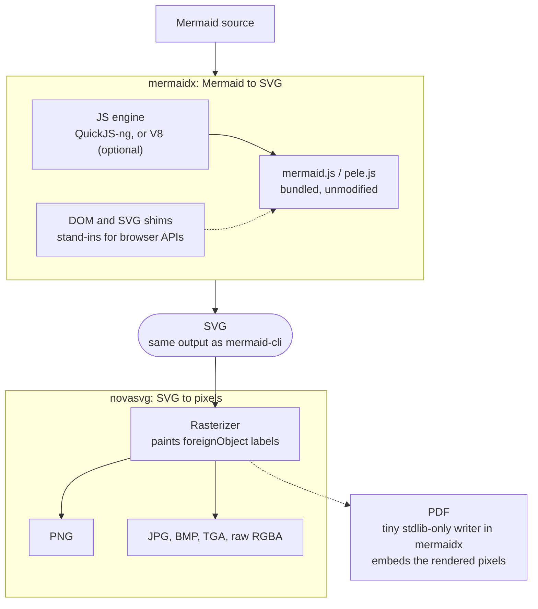
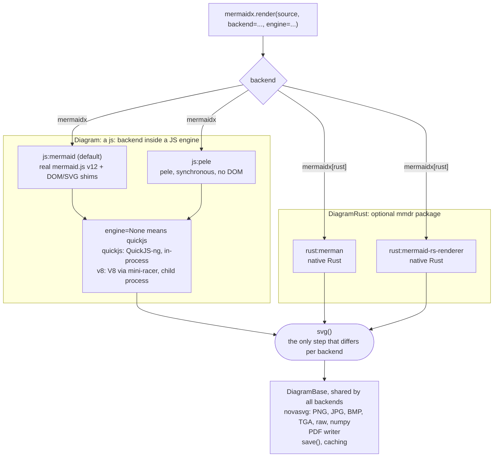

<div align="center">


# mermaidx

**Mermaid diagrams → SVG, PNG, JPG and PDF, from plain Python.**<br/>
No browser. No Node.js. No system packages. Just `pip install mermaidx`.

[](https://pypi.org/project/mermaidx)
[](https://pypi.org/project/mermaidx)
[](https://opensource.org/licenses/MIT)
[](https://github.com/MohammadRaziei/mermaidx/actions/workflows/wheel.yml)
<!-- Static badges: update the two versions with mermaidx/assets/mermaid.js (see its npm version) and mermaidx/assets/pele.js, and the count with mermaidx.backends() plus mermaidx[rust]. -->
[](https://mermaid.js.org)
[](https://pele.run)
[](#backends)
[](https://github.com/MohammadRaziei/mermaidx/stargazers)

[Documentation](https://mohammadraziei.github.io/mermaidx) ·
[Quick start](#quick-start) ·
[How it works](#how-it-works) ·
[Python API](#python-api) ·
[CLI](#cli) ·
[Changelog](CHANGELOG.md)

</div>

---

```python
import mermaidx

d = mermaidx.render("graph TD; A[Install] --> B[Import] --> C[Convert] --> D[Done]")
d.save("diagram.svg")
d.save("diagram.png", scale=2.0)
```

`mermaidx` runs the **real Mermaid 12 JavaScript library** inside a small embedded JS engine instead of a headless Chrome. The result is the same SVG you would get from the official `mermaid-cli`, produced without spawning a browser, which makes it a good fit for CI pipelines, notebooks and serverless functions.

## Highlights

- **Browserless.** No Chromium (~170 MB), no Puppeteer, no Node.js, no compiler. Prebuilt wheels only.
- **The real Mermaid.** Not a reimplementation and not a subset: every diagram type of the Mermaid 12 core, with the ELK layout (`flowchart-elk`, `layout: elk`) and ZenUML.
- **Many outputs.** SVG, PNG, JPG/JPEG, BMP, TGA, PDF, raw RGBA and NumPy arrays.
- **One process.** Synchronous, in-process rendering, plus `render_many()` for parallel batches.
- **Jupyter-ready.** A diagram displays itself as the last expression of a cell.
- **Pluggable backends.** mermaid.js (default), pele, or native Rust (optional), on QuickJS-ng (default) or V8 (optional). pele is far faster than mermaid.js but draws its own layout: see the [benchmarks](https://mohammadraziei.github.io/mermaidx/benchmarks) before you choose.

## Installation

```bash
pip install mermaidx
```

Extras are opt-in:

| Command | Adds |
| --- | --- |
| `pip install mermaidx` | Base install. Default `backend="js:mermaid"` on `engine="quickjs"`, zero system dependencies. |
| `pip install mermaidx[v8engine]` | Real V8 (`mini-racer`) as `engine="v8"`. Faster thanks to JIT, runs in an isolated child process. |
| `pip install mermaidx[rust]` | Native-Rust backends via [`mmdr`](https://github.com/mohammadraziei/mmdr): `rust:merman` and `rust:mermaid-rs-renderer`. |
| `pip install numpy` | Enables `.numpy()` export. |
| `pip install mermaidx[all]` | Every extra above (`v8engine` + `rust` + `numpy`). |

> [!NOTE]
> Coming from `mmdc`? That was this project's old name (until 0.7.0). It is no longer published, so uninstall it and install `mermaidx` instead. The module name changed from `mmdc` to `mermaidx` too. See [History](#history).

## Quick start

[](https://colab.research.google.com/github/mohammadraziei/mermaidx/blob/master/examples/jupyter_demo.ipynb)

```python
import mermaidx

d = mermaidx.render("""
graph TD
    A[Install] --> B[Import]
    B --> C[Convert]
    C --> D[Done]
""")

d.save("diagram.svg")
d.save("diagram.png", scale=2.0)
d.save("diagram.jpg", quality=90)       # also .jpeg / .bmp / .tga
d.save("diagram.pdf", pdf_format="A4")
```

The same from the command line:

```bash
mermaidx -i diagram.mermaid -o diagram.svg
mermaidx -i diagram.mermaid -o diagram.png --scale 2.0
cat diagram.mermaid | mermaidx -i - -o diagram.pdf
```

In Jupyter there is nothing to call. A `Diagram` renders itself, like a DataFrame or a matplotlib figure:

```python
mermaidx.render("flowchart LR; A-->B-->C")   # just shows up
```

## How it works

`mermaidx` has a deliberately narrow job: **turn Mermaid source into an SVG that matches `mermaid-cli`**. Everything after the SVG (PNG, JPG and friends) is [novasvg](https://github.com/mohammadraziei/novasvg)'s job.



| Stage | Who does it | Notes |
| --- | --- | --- |
| **Mermaid → SVG** | `mermaidx` | `mermaid.js` runs unmodified in QuickJS-ng (or V8) against a minimal fake DOM/SVG layer (the shims). Anything a real browser would answer, such as text size via `getBBox`, comes from novasvg's font stack and one bundled font. |
| **SVG → PNG / JPG / BMP / TGA / raw** | [`novasvg`](https://github.com/mohammadraziei/novasvg) | Same bundled font as the layout step, so what Mermaid measured is exactly what gets painted. JPEG has no alpha, so it defaults to a white background. |
| **SVG → PDF** | `mermaidx` | A small hand-written PDF writer (stdlib `zlib`/`struct`) embeds the rasterized pixels. No Pillow, no Cairo, no reportlab. |

Every backend is a small subclass of one shared `DiagramBase` and only overrides the private `_svg()` hook. Everything downstream (`png()`, `pdf()`, `raw()`, `numpy()`, `save()`) is written once and behaves identically no matter which backend produced the SVG.

### Why novasvg?

Mermaid draws its labels as HTML inside `<foreignObject>`. Many SVG rasterizers skip that element, so the text silently disappears or the layout breaks. `mermaidx` originally used `resvg`, which cannot paint `<foreignObject>`, and had to force plain SVG text as a workaround. With novasvg the default HTML labels are used again, and their box sizes are computed by novasvg itself, so layout and paint cannot disagree.

In [novasvg's own benchmark](https://mohammadraziei.github.io/novasvg/benchmarks/) (60 samples, 49 of them Mermaid diagrams, compared against Chromium as ground truth), it came out the most accurate renderer while staying among the fastest:

| Renderer | Samples that look right (of 60) | Mean RMSE vs Chromium (lower is better) | Avg render time |
| --- | :---: | :---: | :---: |
| **novasvg** | **59** | **15.4** | 1.28 ms |
| resvg | 7 | 19.2 | 3.38 ms |
| lunasvg | 31 | 30.9 | 1.85 ms |
| cairosvg | 19 | 46.0 | 42.92 ms |
| nanosvg | 4 | 48.3 | 0.99 ms |
| thorvg | 6 | 76.4 | 0.64 ms |

thorvg and nanosvg are faster, but they get far more samples visibly wrong. See the [benchmark page](https://mohammadraziei.github.io/novasvg/benchmarks/) for the methodology and side-by-side renders.

### Why not a browser?

The official `@mermaid-js/mermaid-cli` drives a real headless Chrome through Puppeteer. That works, but a browser is slow to boot and heavy to install, which shows up directly in wall-clock time for CI jobs that render many diagrams. `mermaidx` removes the browser and nothing else: **same Mermaid library, no browser process, no page load, no DOM boot.**

Every other Mermaid-to-image tool reachable from Python either drives a browser or shells out to Node.js. `mermaidx` is the one that renders current Mermaid with neither.

## Backends

All backends share one API. A backend is named `<kind>:<name>`, and the `js:` backends also take an `engine`. List what is installed at runtime:

```python
import mermaidx

print(mermaidx.backends())
# ['js:mermaid', 'js:pele']                                                 base install
# ['js:mermaid', 'js:pele', 'rust:merman', 'rust:mermaid-rs-renderer']      with mermaidx[rust]

print(mermaidx.available_engines())
# ['quickjs']                                                               base install
# ['quickjs', 'v8']                                                         with mermaidx[v8engine]
```

| Backend | What runs | Notes |
| --- | --- | --- |
| `js:mermaid` *(default)* | The **original mermaid.js** | Same library, same diagram types, same options (`theme`, `config`, `css`). |
| `js:pele` | [**pele**](https://pele.run), a small Mermaid renderer written in JavaScript | Its own layout, not mermaid.js. Themed with CSS variables (`css=`), so `theme` must stay unset. |
| `rust:merman` | A **Rust reimplementation** (`mmdr`) | No JavaScript engine involved. Not mermaid.js. |
| `rust:mermaid-rs-renderer` | A **different Rust reimplementation** (`mmdr`) | Same idea as `rust:merman`, with its own layout engine. |

The `js:` backends run inside a JS engine, chosen with `engine=`. It is `None` unless you set it, which means `quickjs`:

| Engine | What runs | Notes |
| --- | --- | --- |
| `quickjs` *(default)* | QuickJS-ng | Lightweight and always available, runs in-process. Safe for every diagram type, including `mindmap`. |
| `v8` | V8 (`mini-racer`) | Faster thanks to the JIT. Runs in an isolated child process so memory is fully reclaimed. |

A `rust:` backend has no JS engine, so passing `engine=` with one raises `ValueError`.



The API is the same for every backend: `render()` always returns a `Diagram`, and `.svg()`, `.png()`, `.pdf()` and `.save()` work identically whichever one you pick. What is **not** the same is how the SVG gets made, so **speed and the rendered result can differ** between backends:

- **`js:mermaid` is the original mermaid.js.** Only the JavaScript engine differs between `quickjs` and `v8`: V8 is faster, QuickJS installs anywhere. The engine never changes the result. Text is measured with the bundled DejaVu Sans, not with the fonts of a browser, so a diagram can differ from your own `mmdc` run by a fraction of a pixel in text width (see *Known issues* in the docs).
- **`js:pele` is a different implementation**, in JavaScript, and **much faster**: in our timings it renders a small diagram in a few milliseconds where `js:mermaid` takes about a second, over 100 times faster. The price is that its layout and styling differ from mermaid.js, so the output will not match it. The [**Benchmarks** page](https://mohammadraziei.github.io/mermaidx/benchmarks) shows the measured times and every sample rendered by every backend side by side; have a look before you pick one. It takes `config` and `css` but no `theme`: restyle it with its CSS variables, for example `css="svg{--pele-bg:#111;--pele-fg:#eee}"`.
- **`rust:merman` and `rust:mermaid-rs-renderer` are different implementations**, written in Rust rather than JavaScript. Their layout can differ from mermaid.js, they may not support every diagram type, and they take different options (`theme`, `node_spacing`, `rank_spacing`, `aspect_ratio` instead of `config` and `css`).

Whatever the backend, the SVG then goes through the same novasvg rasterizer, so the pixels are painted the same way. Only the SVG it receives differs. (pele paints with nested CSS variables, which novasvg resolves from 0.11.4 on.)

```python
import mermaidx

source = "flowchart LR; A[Parse] --> B[Layout] --> C[Render]"

# Original mermaid.js: same output, different JS engine
mermaidx.render(source).png()                          # js:mermaid on quickjs, the default
mermaidx.render(source, backend="js:mermaid").png()    # the same, spelled out
mermaidx.render(source, engine="v8").png()             # JIT, faster on big batches

# pele: small, its own layout, any engine
mermaidx.render(source, backend="js:pele").png()
mermaidx.render(source, backend="js:pele", engine="v8").png()

# Rust reimplementations: no JS engine, output may differ
mermaidx.render(source, backend="rust:merman").png()
mermaidx.render(source, backend="rust:mermaid-rs-renderer").png()
```

To see the differences yourself, render the same diagram with every backend you have installed:

```python
for name in mermaidx.backends():
    mermaidx.render(source, backend=name).save(f"diagram-{name.replace(':', '-')}.png")
```

Options depend on the backend:

```python
# js:mermaid: theme, config and css
mermaidx.render(source, theme="dark", config={"flowchart": {"curve": "basis"}})

# js:pele: config and css (no theme)
mermaidx.render(source, backend="js:pele", css="svg{--pele-surface:#202020}")

# Rust backends: spacing and aspect ratio
mermaidx.render(source, backend="rust:merman", theme="dark", node_spacing=60, rank_spacing=80)
```

## Python API

`render()` only stores the source. Every `Diagram` method is **lazy and cached**: nothing is computed until you call it, and repeating a call returns the memoized result.

```python
d = mermaidx.render("flowchart LR; A-->B-->C")
d.svg() is d.svg()   # True, the second call is a cache hit
```

| Method | Returns | Notes |
| --- | --- | --- |
| `.svg()` | `str` | |
| `.png(width?, height?, scale?, background?)` | `bytes` | Aspect ratio is always preserved. |
| `.jpg(quality?)`, `.bmp()`, `.tga()` | `bytes` | Same defaults as `.save()`. |
| `.pdf(pdf_format?, pdf_landscape?, pdf_margin?, ...)` | `bytes` | `pdf_format=None` fits the page to the diagram. |
| `.raw(width?, height?, background?)` | `(bytes, w, h)` | Raw RGBA8888, no imaging library. |
| `.numpy(width?, height?, background?)` | `np.ndarray` | `(H, W, 4)` uint8. Requires `numpy`. |
| `.save(path, format=None, ...)` | `None` | Format comes from the extension unless forced with `format=`. |

```python
d.save("out.png")                      # format from the extension
d.save("out.whatever", format="png")   # or forced explicitly
d.save("out.pdf", pdf_format="A4", pdf_margin="1cm")
```

**Themes, config and CSS**

```python
mermaidx.render(source, theme="dark")   # any Mermaid theme: "default", "forest", "dark", "neutral", "neo", "redux", ...
mermaidx.render(source)                 # no theme: Mermaid 12 picks one per diagram type, like mmdc
mermaidx.render(source, config={"flowchart": {"curve": "basis"}})
mermaidx.render(source, css=".node rect { rx: 8; ry: 8; }")
```

**Parallel batches.** Rendering is pure CPU work, so real concurrency means processes rather than `async`. Each worker starts its own engine once and reuses it:

```python
diagrams = mermaidx.render_many(sources, workers=4, theme="dark")
for d, name in zip(diagrams, output_names):
    d.save(name)
```

**Rasterize any SVG** without going through `render()`:

```python
from mermaidx import svg_to_png, svg_to_raw

svg = open("diagram.svg").read()
png = svg_to_png(svg, width=1200, background="#ffffff")
raw, w, h = svg_to_raw(svg)
```

Full reference: [Python API docs](https://mohammadraziei.github.io/mermaidx/docs/api).

## CLI

```bash
mermaidx -i diagram.mermaid                        # SVG to stdout
mermaidx -i diagram.mermaid -o diagram.png         # format from the extension
mermaidx -i diagram.mermaid -o diagram.png -w 1200 # or --scale 2.0
mermaidx -i diagram.mermaid -o diagram.svg --theme dark
mermaidx -i diagram.mermaid -o diagram.pdf --pdf-format A4 --landscape --margin 1cm
mermaidx -i diagram.mermaid -o diagram.svg --config config.json --css style.css
mermaidx -i diagram.mermaid -o diagram.svg --backend js:pele
mermaidx -i diagram.mermaid -o diagram.svg --engine v8        # needs mermaidx[v8engine]
mermaidx -i diagram.mermaid -o diagram.svg --backend rust:merman   # needs mermaidx[rust]

mermaidx --list-backends
mermaidx --info          # bundled Mermaid version
mermaidx --version
```

Use `-q` to silence the "saved to…" message and `--quality N` for JPEG quality. More in the [CLI docs](https://mohammadraziei.github.io/mermaidx/docs/cli).

## Supported diagrams

Everything Mermaid 12 itself supports, because the real library is bundled: flowcharts, sequence, class, state, ER, Gantt, pie, git graphs, mindmaps, timelines, and more. The ELK layout is included: use `flowchart-elk` or `layout: elk`.

ZenUML (`zenuml`) works too, although it is not part of the Mermaid core: it is drawn by the SVG renderer of `@zenuml/core`, as plain SVG. Mermaid's `theme` and `config` do not apply to it, and `js:pele` does not know it. See [backends](https://mohammadraziei.github.io/mermaidx/docs/backends).

## Requirements

- Python 3.9+
- `quickjs-ng`, `novasvg` (installed automatically)
- `mini-racer` (optional, for `engine="v8"`)

## Documentation

| | |
| --- | --- |
| [Quick start](https://mohammadraziei.github.io/mermaidx/docs/quickstart) | [Python API](https://mohammadraziei.github.io/mermaidx/docs/api) |
| [Command line](https://mohammadraziei.github.io/mermaidx/docs/cli) | [Backends](https://mohammadraziei.github.io/mermaidx/docs/backends) |
| [Known issues](https://mohammadraziei.github.io/mermaidx/docs/known-issues) | [Architecture](architecture.md) |

## Testing

```bash
pip install -e ".[test]"
pytest tests/ -v
```

## History

<details>
<summary>How the project got here (mmdc → mermaidx)</summary>

- **0.1.0 to 0.5.0, `mmdc` on [phasma](https://github.com/mohammadraziei/phasma)** (2025-12-26 to 2026-06-28): the original version, named after the `mmdc` command of mermaid-cli. It rendered through PhantomJS driven by phasma (a 25.0 MB wheel at phasma 0.7.1, measured with `pip-size`) and was stuck on mermaid.js 7.1.2, because recent Mermaid needs ES6 and PhantomJS does not have it ([#5](https://github.com/MohammadRaziei/mermaidx/issues/5)).
- **0.6.0 (2026-07-08), a full rewrite**: PhantomJS was removed. mermaid.js now runs inside QuickJS-ng against a hand-written DOM/SVG shim, with resvg for rasterization, and the `Diagram` class and `render()` appeared. 0.6.2 added `backend=`: `js` (renamed `quickjs` in 0.9.0), plus `merman` and `mermaid-rs-renderer` through the optional [`mmdr`](https://github.com/mohammadraziei/mmdr) package.
- **0.7.0 and 0.8.0 (2026-07-10), renamed to mermaidx**: 0.7.0 is the last release under the `mmdc` name, with a deprecation notice; 0.8.0 is the first `mermaidx`. The old name was easy to confuse with the tool this project replaces. **If you have `mmdc` pinned anywhere (`requirements.txt`, a Dockerfile, CI config), switch it to `mermaidx`.**
- **0.9.0 (2026-07-18)**: an optional real-V8 engine (`backend="v8"`, installed today with `mermaidx[v8engine]`) next to the default QuickJS-ng one. Through the 0.9.x series the SVG was patched after rendering so that resvg could draw HTML labels.
- **0.10.0 (2026-10-17)**: novasvg became the only rasterizer and the only text and label measurer, so resvg, the post-render patching and font embedding were removed. Because novasvg paints `<foreignObject>` directly, mermaid.js's default HTML labels are used again (`htmlLabels: true`). JPEG, BMP and TGA output was added, and output is checked structurally against reference SVGs. See the [changelog](CHANGELOG.md) for breaking changes (font embedding removed, `raster="resvg"` now raises `ValueError`).
- **0.11.0 (2026-10-30), breaking**: backends are named `<kind>:<name>` (`js:mermaid`, `rust:merman`), and the JS engine is a separate `engine=` parameter (`quickjs` by default, or `v8`). The pele renderer was added as `js:pele`. See the [changelog](CHANGELOG.md) for how to migrate.

The longer version, in my own words: [The story of mermaidx](https://mohammadraziei.github.io/mermaidx/docs/story).

</details>

## Acknowledgments

- [Mermaid](https://github.com/mermaid-js/mermaid): the diagramming library this project renders. `mermaidx` just runs the real thing somewhere a browser can't go.
- [novasvg](https://github.com/mohammadraziei/novasvg): SVG rasterization, image encoding and text measurement.
- [mmdr](https://github.com/mohammadraziei/mmdr): a native-Rust Mermaid renderer by the same author, usable as an extra backend.

## Contributing

1. Fork and create a feature branch.
2. Add tests for new functionality.
3. Run `pytest tests/`. Everything must pass.
4. Open a pull request.

## License

MIT. See [LICENSE](LICENSE).

---

<div align="center">

If `mermaidx` saves you from booting headless Chrome a hundred times in CI, a ⭐ helps other people find it.

</div>
