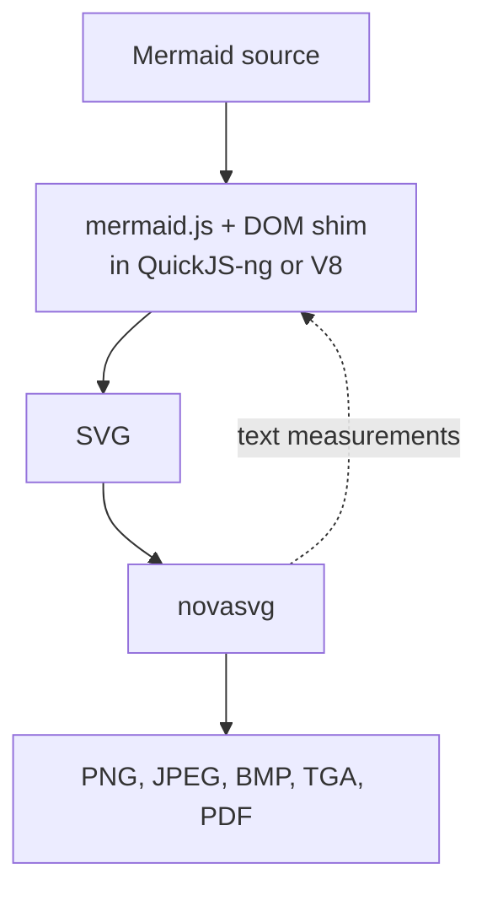

**5.5 MB.** That is what `mermaidx` weighs today, with every dependency included. It turns Mermaid diagrams into SVG, PNG and more, from plain Python, with no Node, no Chromium and no system packages.

Getting there took about ten months, a pile of experiments, and more mistakes than I can count. Along the way a few packages were born, and some of them retired. The first one to go was phasma.

This is the story in my own words. Dates and versions come from the [changelog](./changelog.md) and the git history, and the issues are linked.

## A browser that would not install

It started with [mermaid-cli](https://github.com/mermaid-js/mermaid-cli), the official command line tool for [Mermaid](https://mermaid.js.org). It needs the Node ecosystem. And on top of that, it downloads and installs a complete Chromium. A complete Chromium!

I wanted to run it on a server with no graphical interface. Installing a browser there was hard, and I never managed it. So mermaid-cli was out.

And that was not the only thing bothering me. I hated it on principle. Why should I step out of the Python ecosystem, and pick up system dependencies, just to draw a box and an arrow? Why?

So I went hunting for a headless browser, and that is how I met PhantomJS.

## A dead browser that worked

[PhantomJS](https://github.com/ariya/phantomjs) had expired. It no longer supported the new ES6 features. But the mermaid.js I had in hand, version 7.1.2, ran on it without any trouble!

Still, one problem was left: the user had to download and install PhantomJS separately. A system dependency, again.

I went to PyPI and found [phantomjs-binary](https://pypi.org/project/phantomjs-binary/). It put the binaries for all three platforms inside the package. In one word: it was not done properly.

## phasma is born

So I wrote [phasma](https://github.com/mohammadraziei/phasma). It packaged PhantomJS per operating system, behind an API that feels like [Playwright's](https://playwright.dev/python/). It was even lighter than Playwright's own wheel, and Playwright had not installed a browser yet!

Here comes a confession: I am obsessed with install size. It started with Docker image sizes and spread to my other projects (pygixml, liburlparser, libspeech, libstb, novasvg, httpp, and more). I wanted to ask "how big is this package, with everything it drags in?" without downloading it. So I wrote yet another package, [pip-size](https://github.com/mohammadraziei/pip-size), just for that. Writing a tool to measure your own obsession is probably a bad sign. But look at what it says. The dead browser first:

```text
➜ mohammad@Mohammad  ~  uvx pip-size phantomjs-binary


🔍 Resolving 'phantomjs-binary'...
  ✓ phantomjs-binary==2.1.3  →  phantomjs-binary-2.1.3.tar.gz

  phantomjs-binary==2.1.3  58.4 MB
```

(Note the `.tar.gz`: that one resolved to a source archive.) Then phasma:

```text
➜ mohammad@Mohammad  ~  uvx pip-size phasma


🔍 Resolving 'phasma'...
  ✓ phasma==0.7.1  →  phasma-0.7.1-py3-none-manylinux_2_17_x86_64.whl

  phasma==0.7.1  25.0 MB
```

And Playwright, before it has downloaded a single browser:

```text
➜ mohammad@Mohammad  ~  uvx pip-size playwright


🔍 Resolving 'playwright'...
  ✓ playwright==1.64.0  →  playwright-1.64.0-py3-none-manylinux1_x86_64.whl
    ✓ pyee==14.0.0  →  pyee-14.0.0-py3-none-any.whl
    ✓ greenlet==3.5.6  →  greenlet-3.5.6-cp312-cp312-manylinux_2_24_x86_64.manylinux_2_28_x86_64.whl
      ✓ typing-extensions==4.16.0  →  typing_extensions-4.16.0-py3-none-any.whl

  playwright==1.64.0  46.0 MB  (total: 46.7 MB)
  ├── pyee==14.0.0  15.2 KB  (total: 59.7 KB)
  │   └── typing-extensions==4.16.0  44.5 KB
  └── greenlet==3.5.6  606.8 KB
```

And, as a spoiler for the rest of the story, mermaidx today:

```text
➜ mohammad@Mohammad  ~  uvx pip-size mermaidx


🔍 Resolving 'mermaidx'...
  ✓ mermaidx==0.10.0  →  mermaidx-0.10.0-py3-none-any.whl
    ✓ novasvg==0.11.3  →  novasvg-0.11.3-cp312-abi3-manylinux_2_27_x86_64.manylinux_2_28_x86_64.whl
    ✓ quickjs-ng==0.17.0.1  →  quickjs_ng-0.17.0.1-cp310-abi3-manylinux2014_x86_64.manylinux_2_17_x86_64.manylinux_2_28_x86_64.whl
    ✓ termaid==0.9.1  →  termaid-0.9.1-py3-none-any.whl

  mermaidx==0.10.0  1.7 MB  (total: 5.5 MB)
  ├── novasvg==0.11.3  1.2 MB
  ├── quickjs-ng==0.17.0.1  2.4 MB
  └── termaid==0.9.1  166.5 KB
```

58.4 MB. 25.0 MB. 46.7 MB. And then, 5.5 MB. Hold on to that last number; the rest of the story is how we got there.

If you have never looked at what your dependencies weigh, try it. With [uv](https://docs.astral.sh/uv/) it is `uvx pip-size PACKAGE`, any package name, no download. These are Linux x86-64 numbers; yours may differ.

## mmdc

I called the project `mmdc`, because I had designed it as the equivalent of the `mmdc` command of mermaid-cli, and I built it on phasma. 0.1.0 went out on 2025-12-26, and by 0.5.0, on 2026-06-28, it was still running PhantomJS through phasma.

## The wall

Then, on 2026-04-03, [issue #5](https://github.com/MohammadRaziei/mermaidx/issues/5) made me realize something: my Mermaid version was outdated.

I fought it. I polyfilled. I bundled JavaScript libraries such as a Promise implementation. I tried everything I could think of to fill the ES6 gap in PhantomJS. And I could not do it. It was not going to work.

So I decided to solve the problem in a different way. phasma, my own package, had to go, even though it turned out useful for my other work. On 2026-07-07 the commit message was:

```text
remove phasma and start using quickjs and resvg
```

## Just enough browser

The new engine was [QuickJS-ng](https://github.com/quickjs-ng/quickjs), because its wheel is light. But there was a catch: Mermaid needs a DOM.

Tools like [jsdom](https://github.com/jsdom/jsdom) exist, and they are heavy too. Worse, their goal is to not throw errors, not to tell you exactly how wide a piece of text is. That does not help me at all! So I gave up on that technology as well and wrote a simple `dom_shim.js` for us. The font measurements are computed in Python and passed to QuickJS. (By 0.8.3 the font code was a tiny TrueType reader of my own, working on a bundled [DejaVu Sans](https://dejavu-fonts.github.io/), and a comment in it says it avoids fontTools on purpose.)

Do you see what I was doing? I was simulating a browser! Because we really did need one! Not a complete browser, though. Just enough of one to hand me an SVG.

That was 0.6.0, on 2026-07-08: PhantomJS gone, mermaid.js running in QuickJS-ng against my shim, with [resvg](https://github.com/linebender/resvg) painting the pixels.

And right there I realized `mmdc` was a bad name. It would be confused with the tool it wanted to replace. On 2026-07-10, 0.7.0 went out as the last release under that name, and the same day 0.8.0 became the first `mermaidx`.

## The troubles begin

New problem. An SVG was not enough! Users needed PNG, JPG and more.

[resvg](https://github.com/linebender/resvg), through `resvg_py`, was the industry standard for this. But resvg and the other options were incomplete: they did not render `foreignObject`!!! That was the beginning of my troubles.

The way out looked like this: patch the finished SVG. Take the HTML elements and turn them into SVG elements that an existing renderer, such as resvg (which is fast, by the way), can understand. It was the dirtiest part of the whole project. I kept it going all the way through 0.9.x, and I received a lot of issues about inconsistent output.

## Rust, and the birth of backends

In the middle of this search, I discovered that somebody had written [mermaid-rs-renderer](https://github.com/1jehuang/mermaid-rs-renderer) in Rust. Its speed is naturally excellent! I found nothing for it on PyPI. But I also saw the merman project, which came up in the issues of the other one.

So I decided to write a light binding that handles both as backends, [mmdr](https://github.com/mohammadraziei/mmdr), and to make it an optional dependency (which brings two backends). That is where the concept of a backend was born! 0.6.2 (2026-07-09) added the `backend=` argument.

Then I decided to bring in [V8](https://v8.dev) as an optional dependency too, for the people who care about JIT and its speed. It arrived with 0.9.0 on 2026-07-18. In total: four backends, and the default is the lightest and most plug-and-play one, `quickjs`. (Before 0.9.0, the QuickJS backend was called `js`.)

## Thank you, albert-github

A special thank you to [@albert-github](https://github.com/albert-github), who is active in the [Doxygen](https://www.doxygen.nl) project. He tested this project, opened issue after issue, and was very present in finding its faults. Much of what got fixed is because of him.

## Enough

And then I came to a conclusion: this way of patching was far too dirty. I decided to write my own SVG renderer, in C++!

Why C++? Because it is fast and light, and it can be a practical replacement. With [nanobind](https://github.com/wjakob/nanobind) I could bind it to Python and use it.

The project and its name, [novasvg](https://mohammadraziei.github.io/novasvg/), had actually started before mermaidx, but it was on hold. I picked it up, solved its problems, and kept going. In its [own benchmark](https://mohammadraziei.github.io/novasvg/benchmarks), which I wrote (conflict of interest declared), it was the most accurate of the options I compared, and the speed was great too. The same page shows how the SVGs that mermaid.js produces look in different tools, and why there was no other choice.

novasvg first shows up in mermaidx's history on 2026-09-18, and by 09-28 the migration from resvg was done.

## Undoing everything

Then I went back to mermaidx and reverted every one of those patches! My goal: make the SVG match the golden tests exactly.

Those golden tests were meant to come from the original mermaid-cli. But, as I told you, I could not install it properly on my server, so I generated them with [mermaid.ink](https://mermaid.ink). And when I say "exactly", I do not mean identical bytes. The strict criterion is on the XML: the attributes and the children must be the same, no more and no less. Floating point numbers get a threshold.

For that comparison I used [pygixml](https://mohammadraziei.github.io/pygixml/), a parser I wrote earlier for another project, partly because it keeps the CI test run short.

## The split

So in 0.10.0, on 2026-10-17, the work was split in two:

- **mermaidx** pretends to be a browser and returns the SVG. It was developed with test-driven and error-driven methods.
- **novasvg** turns that SVG into PNG and the other image formats.



And because I wrote both sides, there was one more win! novasvg needs fonts and text layout itself, so I could bind or export its helper functions to Python and use them in mermaidx, for estimating font sizes and so on.

## The graveyard and the survivors

Look at what this story left behind. phasma was born for a dead browser and retired when mermaidx moved to QuickJS, and it was not the only package born and retired along the way. pip-size was born from my size obsession. mmdr was born so that Rust renderers could be backends. novasvg came back to life. And pygixml, an older project, found a new job in the test suite.

Every one of them came from a wall: a browser that would not install, a standard PhantomJS could not run, an element resvg would not paint. The through line never changed: stay inside Python, avoid heavy system dependencies. It took countless experiments, and countless failures, to get here.

The result weighs 5.5 MB, and you can try it:

```text
pip install mermaidx
```

And whatever you install next, ask pip-size first.

## Timeline

| Date | Version | What happened |
| --- | --- | --- |
| 2025-12-26 | 0.1.0 | First release as `mmdc`, on PhantomJS through phasma. |
| 2026-06-28 | 0.5.0 | Still PhantomJS through phasma. |
| 2026-07-08 | 0.6.0 | PhantomJS gone; mermaid.js in QuickJS-ng with a DOM shim; resvg for pixels. |
| 2026-07-09 | 0.6.2 | `backend=` and the Rust backends. |
| 2026-07-10 | 0.7.0, 0.8.0 | Last `mmdc` release, then the rename to `mermaidx`. |
| 2026-07-18 | 0.9.0 | Optional V8 engine. |
| 2026-10-17 | 0.10.0 | novasvg takes over rasterizing; mermaidx returns the SVG. |

## Links

- In this repository: the [changelog](./changelog.md) and [issue #5](https://github.com/MohammadRaziei/mermaidx/issues/5), where the wall was first named.
- The tools in the story: [Mermaid](https://mermaid.js.org), [mermaid-cli](https://github.com/mermaid-js/mermaid-cli), [PhantomJS](https://github.com/ariya/phantomjs), [Playwright for Python](https://playwright.dev/python/), [QuickJS-ng](https://github.com/quickjs-ng/quickjs), [V8](https://v8.dev), [resvg](https://github.com/linebender/resvg), [mermaid.ink](https://mermaid.ink).
- My own packages in the story: [phasma](https://github.com/mohammadraziei/phasma), [pip-size](https://github.com/mohammadraziei/pip-size), [mmdr](https://github.com/mohammadraziei/mmdr), [novasvg](https://mohammadraziei.github.io/novasvg/) and its [benchmarks](https://mohammadraziei.github.io/novasvg/benchmarks), [pygixml](https://mohammadraziei.github.io/pygixml/).