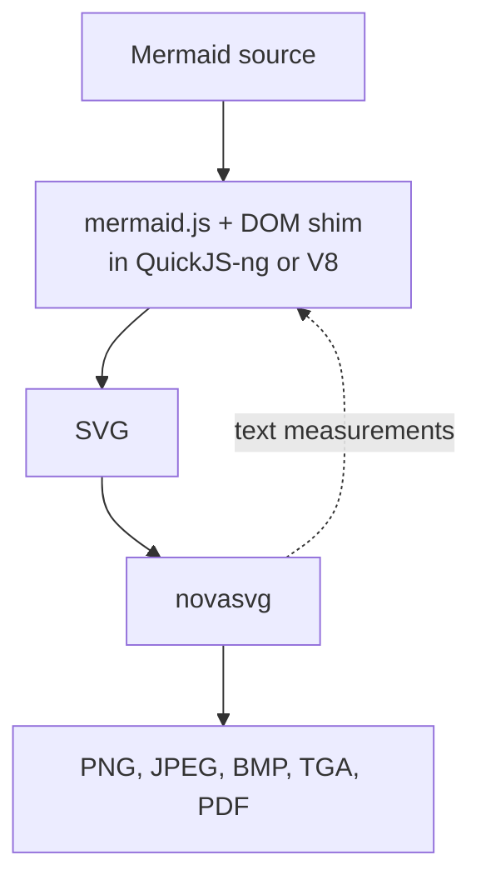

This is the long version of how mermaidx came to be. It is a story of trial and error, with a lot of error in it, and of the packages that were born and then retired along the way. phasma was the first of them.

I tell it in my own words. Where there is a date or a version number, it comes from the [changelog](./changelog.md) or from the git history. Where there is an issue, it is linked. Where it is just me remembering, it is just me remembering. (And yes, I am going to sneak my other projects in. You will notice.)

## 1. A server with no screen

The story starts with [mermaid-cli](https://github.com/mermaid-js/mermaid-cli), the official command line tool for [Mermaid](https://mermaid.js.org). It needs the Node ecosystem, and on top of that it downloads and installs a complete Chromium.

I could not use it. The machine I wanted to run it on was a server with no graphical interface, installing a browser there was hard, and I never managed it.

I also hated the principle of it. Why should a Python project have to step out of the Python ecosystem, and pick up system dependencies, just to draw a box and an arrow? So I went looking for a headless browser, and that is how I met PhantomJS.

## 2. A dead browser

[PhantomJS](https://github.com/ariya/phantomjs) had expired. It no longer supported the newer ES6 features. But it ran the mermaid.js I had, version 7.1.2, without any fuss, so I took it.

One problem was still not solved: with PhantomJS, the user would have to download and install it separately. That is a system dependency again, wearing a different hat.

So I did what you do, and went to PyPI. There I found [phantomjs-binary](https://pypi.org/project/phantomjs-binary/). It put the binaries for all three platforms inside the package. In one word: it was not done properly.

## 3. phasma is born, and so is pip-size

So I wrote [phasma](https://github.com/mohammadraziei/phasma). It packaged PhantomJS per operating system, which is exactly what the other package did not do, behind an API that feels like [Playwright's](https://playwright.dev/python/). It was also lighter than Playwright's own wheel, even though Playwright had not installed a browser yet.

Here I have to confess something: I am obsessive about install size. It started with Docker image sizes and it spread to my other projects (pygixml, liburlparser, libspeech, libstb, novasvg, httpp, and more). At some point I needed to answer "how big is this package, with everything it drags in?" without downloading it, so I wrote another package, [pip-size](https://github.com/mohammadraziei/pip-size), just for that. Writing a tool to measure your own obsession is probably a bad sign. But look what it says. The dead browser first:

```text
➜ mohammad@Mohammad  ~  uvx pip-size phantomjs-binary


🔍 Resolving 'phantomjs-binary'...
  ✓ phantomjs-binary==2.1.3  →  phantomjs-binary-2.1.3.tar.gz

  phantomjs-binary==2.1.3  58.4 MB
```

(Note the `.tar.gz`: that one resolved to a source archive.) Then phasma:

```text
➜ mohammad@Mohammad  ~  uvx pip-size phasma


🔍 Resolving 'phasma'...
  ✓ phasma==0.7.1  →  phasma-0.7.1-py3-none-manylinux_2_17_x86_64.whl

  phasma==0.7.1  25.0 MB
```

And Playwright, before it has downloaded a single browser:

```text
➜ mohammad@Mohammad  ~  uvx pip-size playwright


🔍 Resolving 'playwright'...
  ✓ playwright==1.64.0  →  playwright-1.64.0-py3-none-manylinux1_x86_64.whl
    ✓ pyee==14.0.0  →  pyee-14.0.0-py3-none-any.whl
    ✓ greenlet==3.5.6  →  greenlet-3.5.6-cp312-cp312-manylinux_2_24_x86_64.manylinux_2_28_x86_64.whl
      ✓ typing-extensions==4.16.0  →  typing_extensions-4.16.0-py3-none-any.whl

  playwright==1.64.0  46.0 MB  (total: 46.7 MB)
  ├── pyee==14.0.0  15.2 KB  (total: 59.7 KB)
  │   └── typing-extensions==4.16.0  44.5 KB
  └── greenlet==3.5.6  606.8 KB
```

And, as a spoiler for the rest of this story, mermaidx today:

```text
➜ mohammad@Mohammad  ~  uvx pip-size mermaidx


🔍 Resolving 'mermaidx'...
  ✓ mermaidx==0.10.0  →  mermaidx-0.10.0-py3-none-any.whl
    ✓ novasvg==0.11.3  →  novasvg-0.11.3-cp312-abi3-manylinux_2_27_x86_64.manylinux_2_28_x86_64.whl
    ✓ quickjs-ng==0.17.0.1  →  quickjs_ng-0.17.0.1-cp310-abi3-manylinux2014_x86_64.manylinux_2_17_x86_64.manylinux_2_28_x86_64.whl
    ✓ termaid==0.9.1  →  termaid-0.9.1-py3-none-any.whl

  mermaidx==0.10.0  1.7 MB  (total: 5.5 MB)
  ├── novasvg==0.11.3  1.2 MB
  ├── quickjs-ng==0.17.0.1  2.4 MB
  └── termaid==0.9.1  166.5 KB
```

58.4 MB, 25.0 MB, 46.7 MB, and finally 5.5 MB. That last number is the whole point of the next seven chapters.

If you have never looked at what your dependencies weigh, I recommend trying it. It runs with [uv](https://docs.astral.sh/uv/) as `uvx pip-size PACKAGE`, with any package name, and it measures without downloading. Those are Linux x86-64 numbers; yours may differ.

## 4. In the name of GOD

I called the project `mmdc`, because I had designed it as the equivalent of the `mmdc` command of mermaid-cli, and I built it on phasma.

The first commit in the repository, on 2025-12-25, has the message `In the name of GOD`. The first converter with a PhantomJS driver followed the same day, and 0.1.0 went out on 2025-12-26.

On 2026-01-06 the [Docusaurus](https://docusaurus.io) site appeared, with a hot pink theme (that is literally what the commit says), and 0.4.0 on 01-07 added a logo. On 01-09 the first pull request from someone else showed up ([#1](https://github.com/MohammadRaziei/mermaidx/pull/1)); it was merged on 01-20, and 0.4.1 followed on 01-21.

## 5. The wall

Then it got quiet, but people kept opening issues: [#2](https://github.com/MohammadRaziei/mermaidx/issues/2) on 01-13, [#3](https://github.com/MohammadRaziei/mermaidx/issues/3) on 03-20, [#4](https://github.com/MohammadRaziei/mermaidx/issues/4) on 03-22. Even in the quiet months strangers sent fixes, like the encoding fix in [#7](https://github.com/MohammadRaziei/mermaidx/pull/7) on 04-12.

On 2026-04-03, [issue #5](https://github.com/MohammadRaziei/mermaidx/issues/5) told me what I already half knew: my Mermaid was outdated.

I tried to save it. I polyfilled, and I bundled JavaScript libraries such as a Promise implementation, anything to cover the missing ES6 support in PhantomJS. Nothing worked. As I wrote in that issue, recent Mermaid needs ES6, and PhantomJS cannot give it that. I still made one last push on the old foundation: async support in the CLI, an `--info` flag, and 0.5.0 on 2026-06-28, built on phasma 0.7.1.

On 2026-07-04 I wrote the honest answer in issue #5: the version was stuck at 7.1.2. Three days later, on 2026-07-07, the commit message was:

```text
remove phasma and start using quickjs and resvg
```

## 6. A browser made of lies

If PhantomJS could not run modern Mermaid, I needed another engine. I chose [QuickJS-ng](https://github.com/quickjs-ng/quickjs), because its wheel is light. I had to say goodbye to phasma, which at least turned out to be useful for my other work.

But Mermaid needs a DOM. [jsdom](https://github.com/jsdom/jsdom) and its relatives exist, and they are heavy too. As far as I could tell, their goal is to not throw errors, not to report exact font sizes. That does not help when the layout of a diagram depends on how wide a piece of text is. So I made another decision: no jsdom. I would write a simple `dom_shim.js` myself.

For the text I measured fonts in Python and passed the numbers to QuickJS. (By 0.8.3 the font code was a tiny TrueType reader of my own, working on a bundled [DejaVu Sans](https://dejavu-fonts.github.io/), and a comment in it says it avoids fontTools on purpose.)

In effect I was simulating a browser, because Mermaid really does need one. It just did not need a complete browser. It only had to hand me an SVG.

That was 0.6.0, on 2026-07-08: PhantomJS gone, mermaid.js running in QuickJS-ng against my shim, [resvg](https://github.com/linebender/resvg) painting the pixels, and the `Diagram` class and the `render()` function arriving together.

## 7. A new name

While building the shim, I realised `mmdc` was a bad name. It would be confused with the tool it was trying to replace.

On 2026-07-10, 0.7.0 went out as the last release under that name, with a deprecation notice. 0.8.0 followed the same day, as the first `mermaidx`. 0.8.1 and 0.8.2 came two days later, with sample diagrams and regression tests, and a pile of polyfills for the shim.

## 8. The pixels

An SVG was not enough. People wanted PNG, JPG and the rest. For that conversion, resvg, through the `resvg_py` bindings, was the industry standard. But resvg and the other options I tried were incomplete: they did not render `foreignObject`, which is where Mermaid puts its HTML labels. That was the start of my troubles.

The way forward seemed to be this: take the finished SVG and patch it, turning HTML elements into SVG elements that an existing renderer such as resvg understands. It was the dirtiest part of the project. I kept doing it through the whole 0.9.x series, and I collected many issues about inconsistent output. The patches even got their own tests, like the one from 2026-07-26 for mindmap centering.

## 9. The Rust detour, and how backends were born

In my search I found [mermaid-rs-renderer](https://github.com/1jehuang/mermaid-rs-renderer), a Mermaid renderer written in Rust, which is fast, as you would expect. I found nothing for it on PyPI. I did find the merman project, which came up in the issues of the other one.

So I wrote a light binding, [mmdr](https://github.com/mohammadraziei/mmdr), that handles both as backends, and made it an optional dependency, so it brings in two backends at once. 0.6.0 already carried it as an optional extra, and 0.6.2 (2026-07-09) added the `backend=` argument. That is where the idea of a backend was born.

Then [V8](https://v8.dev) joined as one more optional dependency, for people who care about JIT speed. It arrived with 0.9.0 on 2026-07-18. Altogether that makes four backends: `quickjs`, `v8`, `merman` and `mermaid-rs-renderer`. The default is the lightest one that just works, `quickjs`. (Before 0.9.0, the QuickJS backend was called `js`.)

## 10. The wave

After 0.9.0, 0.9.1 to 0.9.4 shipped within six days. The shim kept learning what a real browser has that I never expected to need: `Intl`, `URL`, `CSS.supports`, `previousSibling`, `toJSON`. On 2026-07-22 I updated the bundled mermaid.js to 11.16.0, which shipped in 0.9.4 on 07-24.

Many of those issues came from [@albert-github](https://github.com/albert-github), who is active in the [Doxygen](https://www.doxygen.nl) project. He tested diagram after diagram and reported what broke. A special thanks to him: this project is better for how much he found.

He was not alone. SailingGreg sent a pull request ([#9](https://github.com/MohammadRaziei/mermaidx/pull/9)) and wrote careful reports in [#8](https://github.com/MohammadRaziei/mermaidx/issues/8) and [#12](https://github.com/MohammadRaziei/mermaidx/issues/12). In [#17](https://github.com/MohammadRaziei/mermaidx/issues/17), chrislee35 traced a text-placement problem down to the details of `getBBox`.

## 11. A month of silence, and a decision

After the wave, the repository went quiet. The only commit in August is on the 31st: it renamed the V8 extra to `mermaidx[v8engine]` and shipped 0.9.5.

Then I came to a conclusion: this way of patching SVGs is too dirty. I would write my own SVG renderer, in C++. Why C++? It is fast and light, and with [nanobind](https://github.com/wjakob/nanobind) it can be bound to Python and used as a practical replacement.

The project and its name, [novasvg](https://mohammadraziei.github.io/novasvg/), had in fact started before mermaidx, but it was on hold. I picked it up, solved its problems, and kept going. In its [own benchmark](https://mohammadraziei.github.io/novasvg/benchmarks), which I wrote (conflict of interest declared), it was the most accurate of the renderers I compared. The same page shows how the SVGs that mermaid.js produces look in different tools, and why I had no other choice.

novasvg first shows up in mermaidx's history on 2026-09-18. A week later the commit message says it plainly, `replace resvg with novasvg`, and on 09-28 the migration was done. JPEG, BMP and TGA output came on 09-29.

## 12. Undoing everything

Then I went back through mermaidx and undid all those patches. The new goal was an SVG that matches golden tests as closely as possible.

I generated the golden SVGs with [mermaid.ink](https://mermaid.ink). The best answer would have been the original mermaid-cli, but as you know, I could not install it properly on my server. And "matches" does not mean identical bytes. The check is on the XML: the attributes and the children must be the same, no more and no less, and only floating point numbers get a threshold. I do the comparison with [pygixml](https://mohammadraziei.github.io/pygixml/), a parser I wrote for an earlier project, and I chose it partly to keep the CI test run short.

The next two weeks were a long argument with Chrome. I made `getBBox` measure the ink of a text the way Chrome does (10-03), canonicalised CSS rules the way a browser's CSSOM does (10-07), and parsed SVG path numbers as 32-bit floats (10-11). On 10-14 I removed font embedding for good.

## 13. The split

So in 0.10.0, on 2026-10-17, the work was split in two:

- **mermaidx** pretends to be a browser and returns the SVG. It was developed with test-driven and error-driven methods.
- **novasvg** turns that SVG into PNG, JPEG, BMP and TGA, and it is also the only thing that measures text and HTML labels.



Having written both sides gave me one more advantage. novasvg needs fonts and text layout anyway, so I could export its helper functions to Python and use them in mermaidx to estimate font sizes.

Along with that, 0.10.0 removed font embedding, resvg and the post-render SVG patching, and put Mermaid's default HTML labels back. The changelog lists the breaking changes. The reference set is 43 samples. On Linux, `quickjs` matches all of them and `v8` matches 42. The exception is `39_mindmap_shapes`, which differs because `Math.sin` gives results one ulp apart in the two engines; it also differs on `quickjs` under macOS. It is described in [Known issues](./known-issues.md).

That same day I wrote the changelog, deleted a Windows note from it because I could not verify it, and brought the documentation site back, this time with benchmarks generated by CI.

## 14. The graveyard and the survivors

Look at what this story left behind. phasma was built for a dead browser and retired when mermaidx moved to QuickJS; it was not the only package born and retired in the process. pip-size was born from my obsession with size. mmdr was born so that Rust renderers could be backends. novasvg was revived, and pygixml, an older project, found a new job in the test suite.

Every one of them came from a wall: a browser that would not install, a standard that PhantomJS could not run, an element resvg would not paint. The through line was always the same: stay inside Python, and avoid heavy system dependencies. It took many experiments, and many failures, to get there.

The result fits in 5.5 MB, and you can try it:

```text
pip install mermaidx
```

And whatever you end up installing next, ask pip-size first.

## Timeline

| Date | Version | What happened |
| --- | --- | --- |
| 2025-12-25 | | First commit. |
| 2025-12-26 | 0.1.0, 0.2.0 | First release as `mmdc`, on PhantomJS through phasma. |
| 2025-12-28 | 0.3.0 | PDF and PNG output. |
| 2026-01-07 | 0.4.0 | Documentation site and logo. |
| 2026-06-28 | 0.5.0 | The first release after a break of about five months. |
| 2026-07-08 | 0.6.0 | PhantomJS gone; mermaid.js in QuickJS-ng with a DOM shim; resvg for pixels. |
| 2026-07-09 | 0.6.2 | `backend=` and the Rust backends. |
| 2026-07-10 | 0.7.0, 0.8.0 | Last `mmdc` release, then the rename to `mermaidx`. |
| 2026-07-12 | 0.8.1, 0.8.2 | Sample tests, more shim polyfills. |
| 2026-07-18 | 0.9.0 | Optional V8 engine. |
| 2026-07-24 | 0.9.4 | Bundled mermaid.js updated to 11.16.0. |
| 2026-08-31 | 0.9.5 | `v8engine` extra, journey and timeline fixes. |
| 2026-10-17 | 0.10.0 | novasvg as the only rasterizer, JPEG/BMP/TGA, browser-faithful output. |

## Links

- In this repository: the [changelog](./changelog.md), [Known issues](./known-issues.md), and [issue #5](https://github.com/MohammadRaziei/mermaidx/issues/5), where the wall was first named.
- The tools in the story: [Mermaid](https://mermaid.js.org), [mermaid-cli](https://github.com/mermaid-js/mermaid-cli), [PhantomJS](https://github.com/ariya/phantomjs), [Playwright for Python](https://playwright.dev/python/), [QuickJS-ng](https://github.com/quickjs-ng/quickjs), [V8](https://v8.dev), [resvg](https://github.com/linebender/resvg), [mermaid.ink](https://mermaid.ink).
- My own packages in the story: [phasma](https://github.com/mohammadraziei/phasma), [pip-size](https://github.com/mohammadraziei/pip-size), [mmdr](https://github.com/mohammadraziei/mmdr), [novasvg](https://mohammadraziei.github.io/novasvg/) and its [benchmarks](https://mohammadraziei.github.io/novasvg/benchmarks), [pygixml](https://mohammadraziei.github.io/pygixml/).