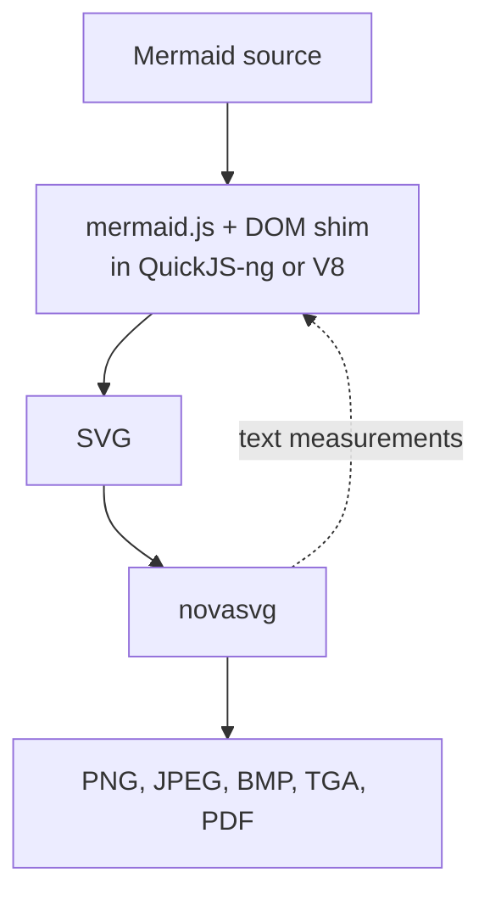

I did not set out to write a rendering engine. I wanted to turn a Mermaid diagram into an SVG from Python, on a server, without anything I would have to apologise for. That simple wish took about ten months, ended up with four backends, and left me with a C++ SVG renderer I never planned to write.

This is the story in my own words. Every date and version comes from the [changelog](./changelog.md) or the git history, and the issues I mention are linked. (Yes, I am going to sneak my other projects into it. You will notice.)

## A browser I could not install

`mermaid-cli` needs the Node ecosystem, and on top of that it downloads and installs a full Chromium. I wanted to render diagrams on a server with no graphical interface, and I never managed to get a browser installed there. So I could not use it.

What bothered me more was the principle. Why should a Python project have to leave the Python ecosystem, and pick up system dependencies, just to draw a box and an arrow? I went looking for a headless browser that would not need all that, and that is how I met PhantomJS.

## A dead browser, and a package to carry it

PhantomJS was already abandoned and had no ES6 support. But it ran the mermaid.js I had at the time (7.1.2) without any trouble. The remaining problem was that every user would have to download and install PhantomJS on their own.

On PyPI I found [phantomjs-binary](https://pypi.org/project/phantomjs-binary/). It puts the binaries for all three platforms into one package, which is not how I think it should be done. So I wrote [phasma](https://github.com/mohammadraziei/phasma): PhantomJS packaged per operating system, behind an API that feels like Playwright's.

I am a little obsessive about install size, because of Docker images and my other packages (pygixml, libspeech, novasvg, and a few more you will meet below). So I also wrote `pip-size`, a tool that tells you how big a package is, dependencies included, without downloading it. Writing a tool to measure your own obsession is probably a bad sign. These are the numbers it gave me:

| Package | Version | Size (with dependencies) |
| --- | --- | --- |
| phantomjs-binary | 2.1.3 | 58.4 MB (resolved as a source archive) |
| phasma | 0.7.1 | 25.0 MB |
| playwright | 1.64.0 | 46.7 MB, before downloading any browser |
| mermaidx | 0.10.0 | 5.5 MB |

You can reproduce them with `uvx pip-size PACKAGE`. They are Linux x86-64 numbers.

## In the name of GOD

The first commit in this repository, on 2025-12-25, has the message `In the name of GOD`. Later that same day came the first converter with a PhantomJS driver. I called the project `mmdc`, because I had designed it as the equivalent of the `mmdc` command of mermaid-cli.

On 2025-12-26 I shipped 0.1.0 and 0.2.0, both in one day: I removed cairosvg from the core dependencies and then put it back. 0.3.0 followed on 12-28 with PDF and PNG output and a release workflow. On 2026-01-06 the Docusaurus site appeared, with a hot pink theme (that is literally what the commit says), and 0.4.0 on 01-07 added a logo. Two days later the first pull request from someone else arrived ([#1](https://github.com/MohammadRaziei/mermaidx/pull/1)), and it was merged on 01-20.

## The wall

Then things got quiet, except that people kept opening issues: [#2](https://github.com/MohammadRaziei/mermaidx/issues/2) on 01-13, [#3](https://github.com/MohammadRaziei/mermaidx/issues/3) on 03-20, [#4](https://github.com/MohammadRaziei/mermaidx/issues/4) on 03-22. On 2026-04-03, [issue #5](https://github.com/MohammadRaziei/mermaidx/issues/5) pointed out what I already half knew: my Mermaid was outdated.

I tried to fix it. I polyfilled, and I bundled JavaScript libraries such as a Promise implementation, to fill the ES6 gap in PhantomJS. It did not work. Recent Mermaid needs ES6, and PhantomJS cannot give it that. I still made one last push on the old foundation: async support in the CLI, an `--info` flag, and 0.5.0 on 2026-06-28, built on phasma 0.7.1.

On 2026-07-04 I wrote an honest answer in issue #5: the version was stuck at 7.1.2. Three days later, on 2026-07-07, the commit message was `remove phasma and start using quickjs and resvg`.

## A browser that only has to give me an SVG

I decided to solve the problem differently. phasma went away, though at least it turned out to be useful for my other work. In its place came QuickJS, which has a light wheel.

But Mermaid needs a DOM. Tools like jsdom exist, but they are heavy, and as far as I could tell their goal is to not throw errors, not to report exact font sizes. That does not help when the layout depends on measured text. So I wrote a small shim, `dom_shim.js`, myself. I measured text in Python, from a bundled font, and handed the numbers to QuickJS. (By 0.8.3 the font code was a tiny TrueType reader of my own, and a comment in it says it deliberately avoids fontTools.)

In effect I was simulating a browser, because Mermaid really does need one. It just did not need a complete browser. It only had to give me the SVG.

This was 0.6.0, on 2026-07-08: PhantomJS removed, mermaid.js running in QuickJS-ng against the shim, resvg doing the pixels, and the `Diagram` class and `render()` arriving together. 0.6.1 added ASCII output the same day.

While doing this I realised `mmdc` was a bad name, because people would confuse it with the tool I was trying to replace. On 2026-07-10, 0.7.0 went out as the last `mmdc` release, with a deprecation notice. 0.8.0 came out the same day as the first `mermaidx`.

## The pixels, and the dirtiest part of the project

An SVG was not enough. People wanted PNG, JPG and more. `resvg_py` was the industry standard for that conversion, but resvg and the other options I tried did not render `foreignObject`, and that is where my trouble began.

The way forward looked like this: take the finished SVG and patch it, turning the HTML elements into SVG elements that an existing renderer such as resvg understands. It was the dirtiest part of the project, and I kept doing it through the whole 0.9.x series. Even the patches got their own tests, like the one from 2026-07-26 for mindmap centering.

## Four backends

While I was searching I found [mermaid-rs-renderer](https://github.com/1jehuang/mermaid-rs-renderer), a Mermaid renderer written in Rust, which is as fast as you would expect. I found nothing for it on PyPI. I also found the merman project, which came up in the issues of the other one. So I wrote a light binding, [mmdr](https://github.com/mohammadraziei/mmdr), that handles both as backends, and made it an optional dependency, so it brings in two backends at once.

That is how the idea of a backend was born. 0.6.2 (2026-07-09) added the `backend=` argument. On 2026-07-18 came 0.9.0 with V8 as one more optional dependency, for people who care about JIT speed. There are now four backends, `quickjs`, `v8`, `merman` and `mermaid-rs-renderer`, and the default is the lightest one that just works, `quickjs`. (Before 0.9.0, the QuickJS backend was called `js`.)

The weeks after 0.9.0 were intense: 0.9.1 to 0.9.4 shipped within six days. The shim kept learning what a browser has that I never thought I would need: `Intl`, `URL`, `CSS.supports`, `previousSibling`, `toJSON`. Many of those came from the issues of [@albert-github](https://github.com/albert-github), who is active in the Doxygen project. He tested diagram after diagram and reported everything that broke. Special thanks to him; this project is better because of how many things he found.

On 2026-07-22 I updated the bundled mermaid.js to 11.16.0, which shipped in 0.9.4 on 07-24. Then the repository went quiet for a month. The only commit in August is on the 31st, the one that renamed the V8 extra to `mermaidx[v8engine]` and shipped 0.9.5.

## The renderer I had been avoiding

In the end I decided the patching was too dirty. I would write my own SVG renderer, in C++. Why C++? It is fast and light, and with nanobind it can be bound to Python and used as a real replacement. The project and its name, [novasvg](https://mohammadraziei.github.io/novasvg/), had actually started before mermaidx but was on hold. I picked it up again and solved its problems. In its [own benchmark](https://mohammadraziei.github.io/novasvg/benchmarks), which I wrote (conflict of interest declared), it was the most accurate of the renderers I compared. The same page shows the SVGs that mermaid.js produces in the different tools, and why I had no other choice.

novasvg first shows up in mermaidx's history on 2026-09-18. A week later the commit message says it plainly, `replace resvg with novasvg`, and on 09-28 the migration was done. JPEG, BMP and TGA output came on 09-29.

Then I went back through mermaidx and removed all the patches. The new goal was an SVG that matches the golden tests as closely as possible. I generated those reference SVGs with mermaid.ink, because I could not install `mermaid-cli` properly on my server. "Matches" does not mean identical bytes. The check is on the XML: attributes and children must be the same, no more and no less, and only floating point numbers get a threshold. I do that comparison with [pygixml](https://mohammadraziei.github.io/pygixml/), a parser I wrote for an earlier project and chose partly to keep the CI test run short.

The next two weeks were a long argument with Chrome. I made `getBBox` measure the ink of a text the way Chrome does (10-03), canonicalised CSS rules the way the browser's CSSOM does (10-07), and parsed SVG path numbers as 32-bit floats (10-11). On 10-14 I removed font embedding for good.

So in 0.10.0, on 2026-10-17, the work was split:

- **mermaidx** pretends to be a browser and returns the SVG. It was developed test-first and error-first.
- **novasvg** turns that SVG into PNG, JPEG, BMP and TGA, and it is also the only thing that measures text and HTML labels.

Because I wrote both, one more thing became possible. novasvg needs fonts and text layout anyway, so I could export its helper functions to Python and use them in mermaidx to estimate font sizes.

Along with that, 0.10.0 removed font embedding, resvg and the post-render SVG patching, and put Mermaid's default HTML labels back. The changelog lists the breaking changes. The reference set is 43 samples. On Linux, `quickjs` matches all of them and `v8` matches 42. The exception is `39_mindmap_shapes`, which differs because `Math.sin` gives results one ulp apart in the two engines; it also differs on `quickjs` under macOS. It is described in [Known issues](./known-issues.md).

That same day I wrote the changelog, deleted a Windows note from it because I could not verify it, and brought the documentation site back, now with benchmarks generated by CI.

So, to count what I wrote along the way: a browser stand-in, a package for a dead browser, a Rust binding, a renderer and a tool to measure package sizes, with a parser from an earlier project doing the testing. It started as a wish for a simple diagram. I am quite happy with how it turned out.

## Timeline

| Date | Version | What happened |
| --- | --- | --- |
| 2025-12-25 | | First commit. |
| 2025-12-26 | 0.1.0, 0.2.0 | First release as `mmdc`, on PhantomJS through phasma. |
| 2025-12-28 | 0.3.0 | PDF and PNG output, release workflow. |
| 2026-01-07 | 0.4.0 | Documentation site and logo. |
| 2026-06-28 | 0.5.0 | The first release after a break of about five months. |
| 2026-07-08 | 0.6.0 | PhantomJS gone; mermaid.js in QuickJS-ng with a DOM shim; resvg for pixels. |
| 2026-07-09 | 0.6.2 | `backend=` and the Rust backends. |
| 2026-07-10 | 0.7.0, 0.8.0 | Last `mmdc` release, then the rename to `mermaidx`. |
| 2026-07-18 | 0.9.0 | Optional V8 engine. |
| 2026-07-24 | 0.9.4 | Bundled mermaid.js updated to 11.16.0. |
| 2026-08-31 | 0.9.5 | `v8engine` extra, journey and timeline fixes. |
| 2026-10-17 | 0.10.0 | novasvg as the only rasterizer, JPEG/BMP/TGA, browser-faithful output. |
